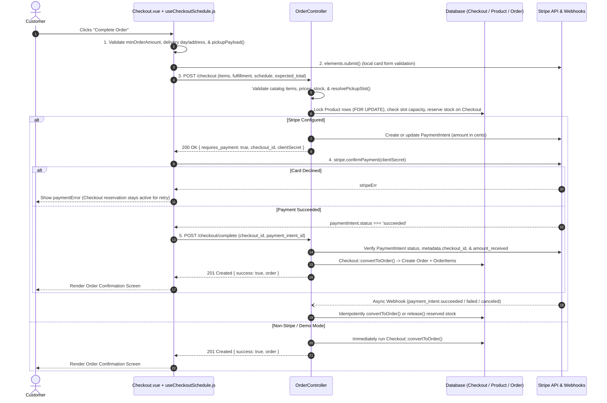

# Checkout Architecture, Flow Plan & Engineering Decisions

This document explains the end-to-end checkout flow for **Masala Mart**, every bug identified across the backend and frontend, and the architectural rationale behind each decision taken.

---

## 1. End-to-End Checkout Flow Plan

The checkout system uses a **two-phase reservation and confirmation architecture** so that inventory and pickup slot capacity are held safely during payment authorization, orders are only created after payment succeeds, and customers can retry a declined card without losing their reservation or double-deducting stock.



---

## 2. Bugs Fixed & Architectural Decisions

### Decision 1: Catch `InsufficientStockException` & `SlotCapacityExceededException` in `OrderController`
- **Files:** [`app/Http/Controllers/OrderController.php`](file:///Users/prashanttanwar/Documents/store/app/Http/Controllers/OrderController.php)
- **Bug Found:**
  - `OrderController` caught `InsufficientStockException` in `startCheckout()` and `completeCheckout()`, but **`use App\Exceptions\InsufficientStockException;` was never imported** at the top of `OrderController.php`.
  - PHP resolved the catch block to the non-existent `App\Http\Controllers\InsufficientStockException`. Whenever `Checkout::convertToOrder()` threw `InsufficientStockException` or its subclass `SlotCapacityExceededException`, it escaped the `catch` block, left the `Checkout` reservation unreleased in non-Stripe mode, and crashed with a `500 Internal Server Error` instead of returning a `422 Unprocessable Entity` validation response or issuing an automatic Stripe refund.
  - Additionally, when `SlotCapacityExceededException` was caught in `startCheckout()`, the response only populated `items` and `error_code`, omitting `pickup_slot`.
- **Decision & Why:**
  - Imported `App\Exceptions\InsufficientStockException` and updated `startCheckout()` to include `'pickup_slot' => [$e->getMessage()]` when `$e instanceof SlotCapacityExceededException`.
  - **Why:** Domain exceptions for stock and slot capacity are recoverable user-facing states. Catching them properly guarantees that non-Stripe checkouts release their `Checkout` row cleanly and return structured `422` validation errors, while Stripe checkouts trigger an automatic refund (`slot_full_refunded` / `out_of_stock_refunded`) if capacity or stock is exhausted during finalization.

---

### Decision 2: Fix ASAP Pickup Midnight Rollover Vulnerability
- **Files:** [`app/Http/Controllers/OrderController.php`](file:///Users/prashanttanwar/Documents/store/app/Http/Controllers/OrderController.php)
- **Bug Found:**
  - In `OrderController::resolvePickupSlot()`, ASAP pickup checked whether the order's ready time (`now + prepMinutes`) was within operating hours by comparing `H:i` strings:
    ```php
    $time = $now->copy()->addMinutes($prepMinutes)->format('H:i');
    if ($now->format('H:i') < $start || $time < $start || $time > $end)
    ```
  - If a store closed late (e.g. `23:55`) and a customer ordered at `23:50` with a 15-minute prep buffer, `$now->copy()->addMinutes(15)` crossed midnight into `00:05` the next day. Lexicographically, `'00:05' <= '23:55'` evaluated to `true` (when `$start` was `'00:00'`), allowing after-hours ASAP orders to slip through.
- **Decision & Why:**
  - Replaced string comparison with full `Carbon` timestamp comparisons (`$startAt`, `$endAt`, `$readyAt`) anchored on `$now`, plus an explicit `! $readyAt->isSameDay($now)` guard.
  - **Why:** Time arithmetic that adds minutes (`addMinutes($prepMinutes)`) can cross day boundaries. Comparing `Carbon` instances on the same calendar date eliminates midnight string-wrapping bugs completely.

---

### Decision 3: Preserve `PickupError` Across Automatic Slot Recovery (`nextTick` Ordering)
- **Files:** [`resources/js/Pages/Checkout.vue`](file:///Users/prashanttanwar/Documents/store/resources/js/Pages/Checkout.vue)
- **Bug Found:**
  - When `POST /checkout` returned a `422` pickup error (e.g., `slot_full` or `slot_expired`), `completeOrder()` assigned `pickupError.value = msg` and immediately mutated `selectedScheduledTime.value = nextValid.label` to pre-select the next available slot.
  - However, `Checkout.vue` had a reactive watcher on `selectedScheduledTime` that clears `pickupError.value = ''` and `errorMessage.value = ''`. Because Vue flushes watchers asynchronously on the next microtask, the programmatic slot change immediately wiped out `pickupError` and `errorMessage`, causing the checkout to fail silently with no visible explanation.
  - Furthermore, Step 01 in `Checkout.vue` rendered **two duplicate pickup error banners** simultaneously whenever `pickupError || scheduleError` was truthy.
- **Decision & Why:**
  - Reordered `completeOrder()` so programmatic state recovery (`pickupTimingMode.value = 'scheduled'` and `selectedScheduledTime.value = nextValid.label`) happens **before** `await nextTick()`, and `pickupError.value = msg` is set **after** `await nextTick()`.
  - Consolidated the two pickup error banners in Step 01 into a single banner containing both **"Change Time"** (which opens the schedule modal) and **"Dismiss"**.
  - **Why:** Auto-advancing to the next open slot is great UX, but the customer must still see *why* their previous attempt wasn't submitted and that their slot was updated. Waiting for `nextTick()` lets the reactive watcher flush cleanly before setting the error banner.

---

### Decision 4: Fix ASAP Expiry Race & Timezone Weekday Shift in `useCheckoutSchedule.js`
- **Files:** [`resources/js/composables/useCheckoutSchedule.js`](file:///Users/prashanttanwar/Documents/store/resources/js/composables/useCheckoutSchedule.js)
- **Bugs Found:**
  1. **UTC+13 / UTC-12 Weekday Shift:** `pickupOptions()` constructed `date = new Date("${baseDate}T12:00:00Z")` (where `baseDate` was already resolved in `storeTimezone`), and then formatted `date` using `{ timeZone: storeTimezone, weekday: 'long' }`. For timezones ahead of UTC by >12 hours (such as `Pacific/Auckland`, UTC+13), `12:00:00Z` is `01:00` the **next day**, shifting the weekday check by +1 day.
  2. **ASAP Expiry While Page Is Open:** `scheduleError` returned `''` unconditionally whenever `pickupTimingMode.value !== 'scheduled'`. And in `pickupPayload()`, `now.value = new Date()` updated reactive time, which only triggered the watcher to switch `pickupTimingMode` to `'scheduled'` *after* `pickupPayload()` had already returned `{ pickup_timing_mode: 'asap' }`.
- **Decision & Why:**
  - Formatted `date` and `todayDate` with `timeZone: 'UTC'` when extracting `weekday: 'long'` (since `baseDate` is already the calendar date in `storeTimezone`), and normalized `pickupDays` to lowercase.
  - Updated `scheduleError` to validate ASAP mode (`!todayOptions.value.isDayOpen` and `!isAsapAvailable.value`) and updated `pickupPayload()` to synchronously check `if (pickupTimingMode.value === 'asap' && !isAsapAvailable.value)` right after refreshing `now.value = new Date()`, switching to `'scheduled'` and throwing a clear message before any network request is made.
  - **Why:** Prevents stale tabs from submitting expired ASAP orders and ensures `pickupDays` works identically in all IANA timezones.

---

### Decision 5: Align Home Delivery Off-Day UI With Backend Enforcement
- **Files:** [`resources/js/Pages/Checkout.vue`](file:///Users/prashanttanwar/Documents/store/resources/js/Pages/Checkout.vue)
- **Bug Found:**
  - On days when Home Delivery is not scheduled (`!storeInfo.is_delivery_available_today`), the UI banner told the customer: *"Orders placed today will be delivered on the next scheduled run"* and allowed them to click Pay, whereas `OrderController::resolvePickupSlot()` immediately rejected the request with `422` (`error_code: 'delivery_off_day'`, field `fulfillment_type`), and `Checkout.vue` did not route `fulfillment_type` or `delivery_off_day` to `deliveryError`.
- **Decision & Why:**
  - Updated the off-day delivery notice in `Checkout.vue` to clearly inform the customer that Home Delivery only runs on configured delivery days and ask them to switch to **Store Pickup** today.
  - Disabled the Pay button when `fulfillmentMode === 'delivery' && storeInfo.is_delivery_available_today === false`, added a guard in `completeOrder()`, and routed `fulfillment_type` / `delivery_off_day` / `delivery_disabled` to `deliveryError`.
  - **Why:** The UI must never invite a customer to fill out their address and card details for a fulfillment option that the server will deterministically reject.

---

### Decision 6: Dedicated "Payment Received — Confirming Order" Screen on Network Drop After Stripe Charge
- **Files:** [`resources/js/Pages/Checkout.vue`](file:///Users/prashanttanwar/Documents/store/resources/js/Pages/Checkout.vue)
- **Bug Found:**
  - If `stripe.confirmPayment()` succeeded (`paymentIntent.status === 'succeeded'`) but the subsequent `POST /checkout/complete` HTTP call failed due to a transient connection drop or timeout, `completeOrder()` called `store.clearCart()` and set `generalError.value = 'Payment received...'` while `orderPlaced.value` remained `false`.
  - Because the template branched on `v-if="orderPlaced"` -> `v-else-if="store.cartItems.length === 0"`, clearing the cart caused the page to immediately render **"Your cart is empty"** and hide the `generalError` banner inside the `v-else` branch!
- **Decision & Why:**
  - Added a dedicated `paymentPendingConfirmation` state and `v-else-if="paymentPendingConfirmation"` confirmation card that displays the amount paid, fulfillment window, address, and a reassuring message that payment was received and the order is being finalized via webhook, with links to `/account` and `/`.
  - **Why:** After a customer's card is charged, showing "Your cart is empty" is alarming and erodes trust. A dedicated confirmation state reassures the customer while the Stripe `payment_intent.succeeded` webhook completes `Checkout::convertToOrder()` in the background.

---

### Decision 7: Unify Catalog Identity for Recipe Kits & Interactive "Masala Dabba" Spices
- **Files:**
  - [`resources/js/stores/cart.js`](file:///Users/prashanttanwar/Documents/store/resources/js/stores/cart.js)
  - [`resources/js/Pages/Home.vue`](file:///Users/prashanttanwar/Documents/store/resources/js/Pages/Home.vue)
  - [`resources/js/Pages/Search.vue`](file:///Users/prashanttanwar/Documents/store/resources/js/Pages/Search.vue)
  - [`app/Http/Controllers/OrderController.php`](file:///Users/prashanttanwar/Documents/store/app/Http/Controllers/OrderController.php)
  - [`database/seeders/ProductSeeder.php`](file:///Users/prashanttanwar/Documents/store/database/seeders/ProductSeeder.php)
- **Bugs Found:**
  1. **Interactive Masala Dabba Builder (`Home.vue`):** Used hardcoded fake numeric IDs `101`–`107` that did not exist in the `products` table, causing `POST /checkout` to fail with `422 This item is no longer available`.
  2. **Recipe Kit Cart Collisions (`cart.js`, `Home.vue`, `Search.vue`):** `handleAddKitToCart` added kits with `id: kit.id` (e.g. `1`) without `type: 'recipe-kit'` or `slug: kit.slug`. In `cart.js`, `cartItems` matched `products.value.find(p => p.id == item.id)`—colliding with regular `Product #1` in the catalog, overwriting the Recipe Kit's name and price with Product #1, and sending `type: 'product'` at checkout.
- **Decision & Why:**
  - Updated `handleAddKitToCart` in `Home.vue` and `Search.vue` to pass `slug: kit.slug, type: 'recipe-kit', isRecipeKit: true`.
  - Updated `cart.js` to store `id: product.slug` and `type: 'recipe-kit'` for recipe kits, and guarded `products.value.find(...)` so recipe kits only match recipe kits (`Boolean(p.isRecipeKit) === isKit`).
  - Added a fallback in `OrderController::validateOrderRequirements()` so even if a legacy cart item sends `type: 'product'` with a non-numeric slug ID, it still checks `RecipeKit` before failing.
  - Replaced fake IDs `101`–`107` in `Home.vue` with canonical spice slugs (`haldi`, `jeera`, `rai`, `dhaniya`, `mirch`, `garam-masala`, `hing`) and seeded all 7 spices in `ProductSeeder.php`.
  - **Why:** Prevents ID space collisions between `products` and `recipe_kits` in both Pinia (`localStorage`) and `OrderController`, and ensures every interactive storefront feature can complete checkout end-to-end.

---

### Decision 8: Clean Order Notes & Full Confirmed Delivery Address Display
- **Files:** [`resources/js/Pages/Checkout.vue`](file:///Users/prashanttanwar/Documents/store/resources/js/Pages/Checkout.vue)
- **Bugs Found:**
  - For Store Pickup orders, `Checkout.vue` sent `notes: storeInfo.value.curbside_instructions || null`, saving the store's own static curbside instructions into the customer's `orders.notes` column on every pickup order.
  - On the Order Confirmation card, the location row displayed raw `deliveryAddress` instead of the formatted address including the apartment/unit (`Apt 4B`).
- **Decision & Why:**
  - Changed `notes` payload to `isDelivery ? (deliveryNotes.value.trim() || null) : null` and bound the confirmation screen location to `confirmedLocationLabel` (`order.delivery_address` / `formattedDeliveryAddress`).
  - **Why:** `orders.notes` should only store customer-supplied instructions, and the confirmation receipt should reflect the exact address (including apartment/suite) saved on the order.

